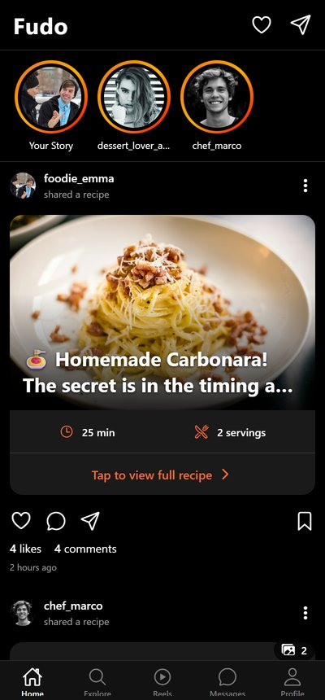
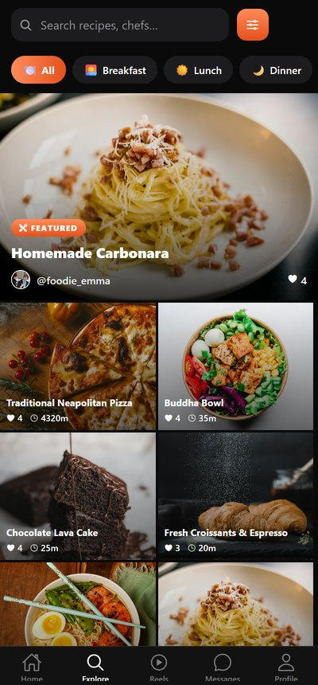
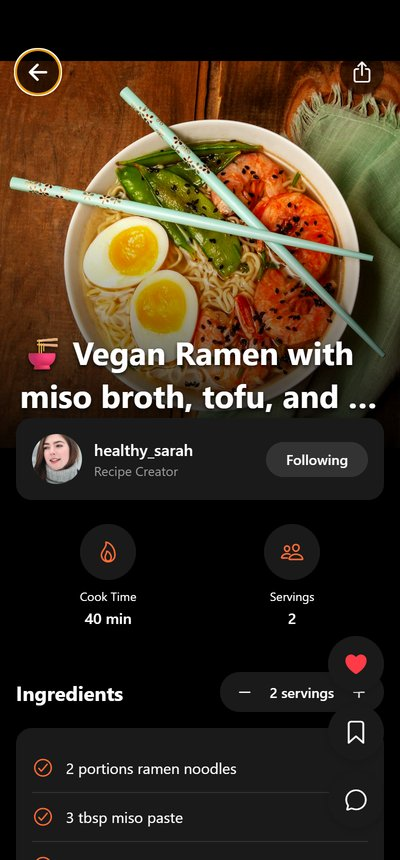
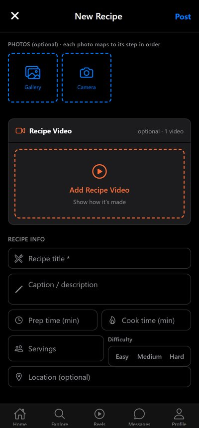
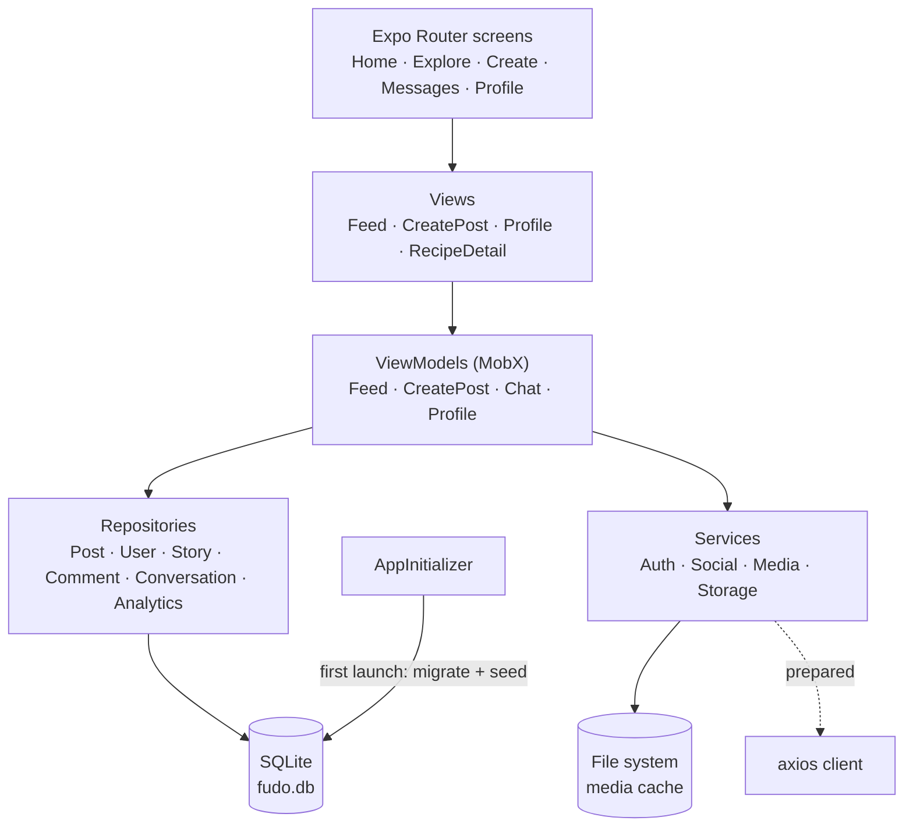
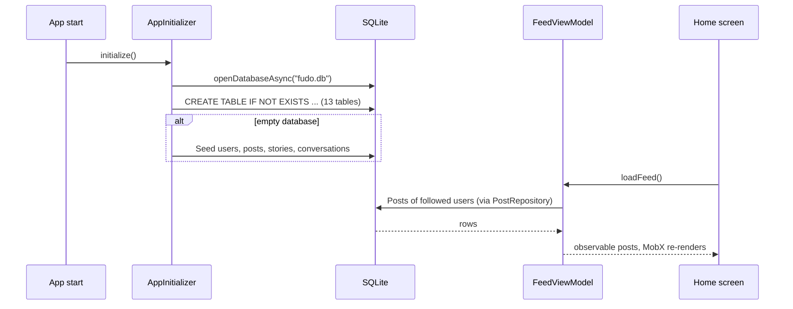
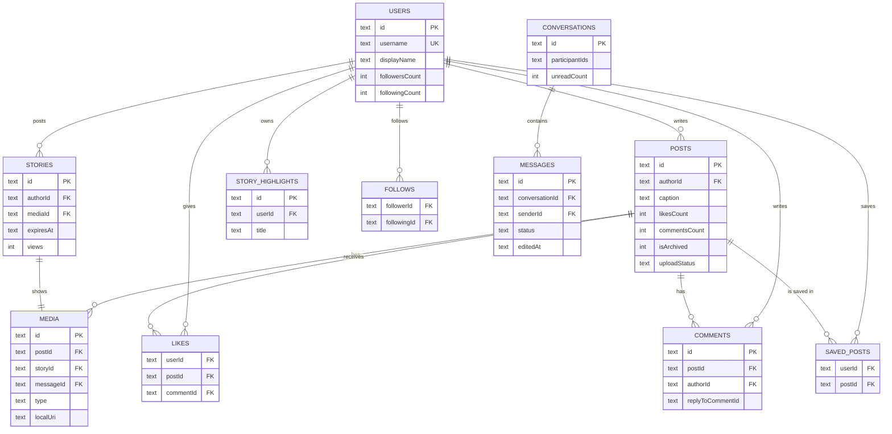

<div align="center">

# Fudo: Food Recipe Social App (first version)

**The first version of Fudo: an offline-first React Native app that works like Instagram, but for recipes**

Posts with photos and recipe details, 24-hour stories, direct messages, follows and engagement
analytics, all stored locally in SQLite so the app works without a network.


[Current version (Fudo-Frontend)](https://github.com/QaisRjoob/Fudo-Frontend) ·
[Backend](https://github.com/QaisRjoob/Fudo-Backend) ·
[Screenshots](#-screenshots) ·
[Architecture](#-architecture) ·
[Data model](#-data-model)

</div>

> [!NOTE]
> This repository holds the **first version** of the Fudo app (November 2025). Development continued
> in **[Fudo-Frontend](https://github.com/QaisRjoob/Fudo-Frontend)**, which has the complete
> dependency list, tests and more screens. Use that repository to run the app.

---

## Table of contents

1. [Overview](#-overview)
2. [Screenshots](#-screenshots)
3. [Features](#-features)
4. [Tech stack](#-tech-stack)
5. [Architecture](#-architecture)
6. [Data flow](#-data-flow)
7. [Data model](#-data-model)
8. [Project structure](#-project-structure)
9. [Version history](#-version-history)

---

## 📌 Overview

Fudo is a social network for people who cook. This first version proved the core idea: an **MVVM**
app with a **repository layer over SQLite**, so every screen works offline from the first launch. On
the first start the app creates the database, runs the migrations and seeds sample users, posts,
stories and conversations, so there is something to explore right away.

The HTTP client for a backend (`src/api/client.ts`) was prepared here and later connected to the
Spring Boot microservices in [Fudo-Backend](https://github.com/QaisRjoob/Fudo-Backend).

---

## 📸 Screenshots

<table>
  <tr>
    <th>Sign in</th>
    <th>Home feed</th>
    <th>Explore</th>
    <th>Recipe details</th>
    <th>New recipe</th>
  </tr>
  <tr>
    <td></td>
    <td></td>
    <td></td>
    <td></td>
    <td></td>
  </tr>
</table>

<sub>Captured from the current version of the app (<a href="https://github.com/QaisRjoob/Fudo-Frontend">Fudo-Frontend</a>) running on the web with its seeded sample data.</sub>

---

## ✨ Features

| Area | What you can do |
|---|---|
| **Posts** | Create, edit and delete posts with several images and a caption |
| **Stories** | 24-hour stories with replies and highlights |
| **Chat** | One-to-one conversations; edit and unsend messages; sending → sent → delivered → read |
| **Social** | Follow and unfollow, like, comment, save; public and private accounts |
| **Explore** | Discover recipes and creators |
| **Profile and analytics** | Post grid, follower counts, views, likes, saves and impressions |
| **Offline-first** | Everything is stored in SQLite and the media cache |

---

## 🧰 Tech stack

| Layer | Technologies |
|---|---|
| App | React Native with Expo, Expo Router (file-based tabs and screens) |
| Language | TypeScript |
| State | MobX, mobx-react-lite |
| Storage | expo-sqlite, expo-file-system, AsyncStorage |
| Media | expo-image, expo-image-picker, expo-image-manipulator |
| Networking | axios (client prepared for the backend) |
| Testing | Jest, @testing-library/react-native |

---

## 🏗️ Architecture



---

## 🔄 Data flow

First launch and the first screen:



---

## 🗄️ Data model



`analytics_events` and `user_settings` complete the 13 tables.

---

## 📂 Project structure

```text
app/                 # Expo Router: (tabs) home, explore, create, messages, profile; login; signup
src/
├── views/           # Feed, CreatePost, Profile, RecipeDetail, Login, Signup
├── viewmodels/      # MobX ViewModels
├── repositories/    # SQLite data access
├── services/        # Auth, Social, Media, Storage
├── models/          # User, Post, Story, Message, Comment, Analytics, ...
├── db/              # database.ts (schema), seedData.ts
├── navigation/      # Navigator and route types
├── api/             # axios client
└── utils/           # AppInitializer
docs/                # Integration guide, quick start, social system design
```

---

## 🕓 Version history

| Version | Repository | What changed |
|---|---|---|
| 1 (Nov 2025) | Fudo-App (this repo) | MVVM + SQLite, posts, stories, chat, social graph, analytics |
| 2 | [Fudo-Frontend](https://github.com/QaisRjoob/Fudo-Frontend) | More screens (Reels, Explore, Story viewer, Settings), optimistic updates, tests, Docker dev server |
| Backend | [Fudo-Backend](https://github.com/QaisRjoob/Fudo-Backend) | 8 Spring Boot microservices behind Spring Cloud Gateway |

---

<div align="center">

Built by [Qais Rjoob](https://github.com/QaisRjoob)

</div>
